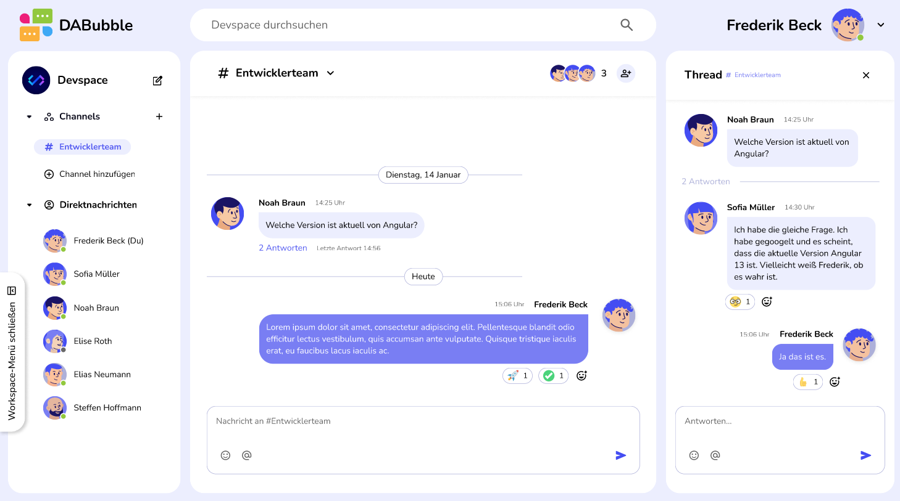

## DABubble

DABubble is a realtime communication platform inspired by modern workplace messaging tools such as Slack and Discord.

  

## 1. Project Overview
Users can communicate through channels, direct messages, and threads while receiving realtime updates powered by Firebase Firestore.
Built with Angular 21, Signals, Firebase Authentication and Firestore.

# 2. Key Features
- Authentication and guest access
- Public channels
- Direct messages
- Threaded conversations
- Realtime Firestore updates
- User profiles
- Member management
- Full responsive desktop and mobile experience
- Reusable overlay system
- Global search across users, channels and messages

## 3. Tech Stack

- Angular
- TypeScript
- SCSS
- Angular Signals
- Firebase Authentication

## 4. Architecture
DaBubble follows a service-driven architecture.
Components remain focused on presentation and interaction while application state is centralized inside dedicated Angular services using Signals.

Firestore
    ↓
Services
    ↓
Signals
    ↓
Components

## 5. State Management

The application uses Angular Signals as the primary state management mechanism.
Instead of passing state only through the component tree, shared state is managed by services such as:

- ChatStateService
- UserService
- ChannelService
- ThreadService
- DmConversationService

ChatStateService acts as the single source of truth for the active workspace view, selected channel, selected direct message and active thread.

## 6. Responsive Navigation

Desktop and mobile layouts are handled differently.

Desktop:
Sidebar | Chat | Thread

Mobile:
Sidebar → Chat → Thread

The mobile experience is controlled through a centralized navigation state stored inside ChatStateService.
This allows components to react consistently to navigation events while avoiding duplicated viewport logic.

## 7. Search System

The search feature aggregates results from three independent data sources:

- Users
- Channels
- Messages

Results are normalized into a shared SearchResult interface and processed through computed Angular Signals.
This keeps the UI independent from the underlying entity type while allowing a single search experience.

## 8. Firebase Integration

Firebase Authentication is used for user authentication.

Users can authenticate through:

- Google Authentication
- Email and password authentication
- Guest access

Firestore powers realtime synchronization of:
- Channels
- Messages
- Direct messages
- Threads
- User profiles

## 9. Overlay Architecture

A reusable overlay component powers all modal interactions.

Different views are loaded dynamically through a shared overlay state:

- User profile
- Edit profile
- Create channel
- Channel details
- Add members
- Logout

## 10. Technical challenges

### 10.1 Responsive Workspace Architecture

One of the main challenges was designing a responsive workspace capable of supporting both desktop and mobile navigation patterns.
Desktop users interact with three simultaneous panels: Sidebar | Chat | Thread
while mobile users navigate through a state-driven flow: Sidebar → Chat → Thread
To solve this, application navigation was centralized inside a dedicated ChatStateService using Angular Signals as the single source of truth.
---

### 10.2 Realtime UI Synchronization

A recurring challenge throughout the project involved keeping the user interface synchronized with asynchronous Firestore updates. One example was the message editing workflow.
Firestore updates were successfully persisted after the first save action, but the editing state remained visible until a second user interaction triggered Angular's change detection cycle.
To ensure immediate visual feedback, ChangeDetectorRef was introduced to synchronize local UI state changes with asynchronous database updates, allowing the editing mode to close immediately after a successful update.

---

### 10.3 Overlay and Interaction Complexity

A significant portion of the project complexity came from designing and coordinating numerous user interactions rather than implementing the underlying CRUD operations.
The application contains more than ten dialog and overlay views, including:
- User profiles
- Profile editing
- Channel creation
- Channel management
- Member invitations
- Member selection
- Direct message creation
- Message editing
- Logout confirmation
- Thread interactions

Managing transitions, overlay states, focus handling, and interaction consistency across desktop and mobile devices became one of the most challenging aspects of the project.

---

### 10.4 Message Reactions and Micro-Interactions

Beyond core messaging functionality, considerable effort was invested in creating responsive micro-interactions that make the application feel natural and intuitive.

Examples include:
- Message hover actions
- Emoji reaction menus
- Thread previews
- Interactive feedback states

Many of these interactions required careful coordination between Angular Signals, component state, Firestore updates, and Angular's change detection system to ensure immediate visual feedback.

## Project Reflection

DaBubble was initially intended to be developed as part of a team project. The final application, however, was completed independently.
Working as the sole developer meant taking responsibility for every aspect of the project lifecycle, from architecture and database design to responsive layouts, realtime synchronization, debugging, and documentation.

One of the most valuable lessons learned throughout the development process was that the greatest challenges were not the individual features themselves, but the interactions between them. Coordinating overlays, dialogs, message reactions, responsive navigation states, and realtime Firestore updates required careful architectural planning.

Completing the project independently provided practical experience in designing and maintaining a medium-sized Angular application from concept to deployment.
